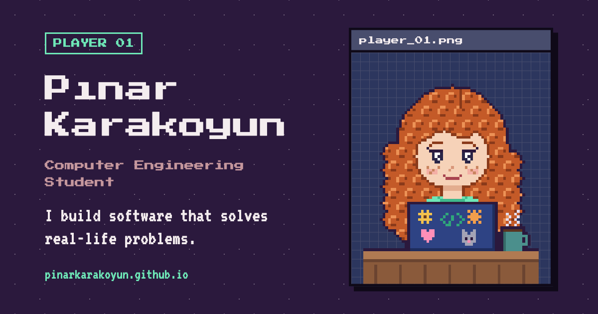

# pinarkarakoyun.github.io

My personal portfolio: a retro pixel game–style website built with React and Vite.

**Live site:** https://pinarkarakoyun.github.io



## About

I'm a senior Computer Engineering student at Antalya Bilim University. Most of my projects start with a real-life problem I notice around me, and this site tells their stories as **problem → solution** cards.

## Features

- **Pixel art avatar** drawn from a text grid (64×80) and rendered as crisp SVG
- **Walking cat** on the avatar's desk: click it to see hearts and watch it sit
- **TR / EN** language toggle: starts in the browser's language and remembers your choice
- **Night / day themes**: follows the system setting until you pick one, with no flash of the wrong theme on load
- **Projects** with status badges (completed, prototype, in progress, planning)
- **Experience timeline**, certificates, skill inventory and language levels
- **Accessible**: keyboard navigation, skip link, screen reader labels, 44px touch targets, WCAG AA contrast in both themes, reduced motion support

## Tech stack

| | |
|---|---|
| Framework | React 19 + Vite |
| Styling | Plain CSS with design tokens (CSS custom properties) |
| Fonts | Press Start 2P, VT323 |
| Linting | oxlint |
| Hosting | GitHub Pages, deployed by GitHub Actions on every push to `main` |

## Project structure

```
src/
  components/   UI pieces (Navbar, Hero, ProjectCard, Experience, Skills, Contact…)
    avatar/     pixel avatar data and component
    cat/        walking cat sprites and movement logic
    pixel/      shared grid-to-SVG renderer
  data/         content: profile, projects, experience, skills (TR + EN)
  i18n/         language context, translate helper, UI strings
  theme/        night / day theme hook
  styles/       design tokens and global styles
```

Content and code are kept apart: adding a project means adding one object to `src/data/projects.js`.

## Running locally

```bash
npm install
npm run dev      # http://localhost:5173
npm run lint
npm run build    # production build in dist/
npm run cv       # regenerate the CV PDFs (needs Google Chrome)
```

## CV

`cv.html` is a printable one-page CV built from the same data files as the site (`src/data`), with short CV-specific texts in `src/data/cv.js`. `npm run cv` prints it to PDF with headless Chrome and checks that every PDF is exactly one page:

- `public/cv/pinar-karakoyun-cv-{tr,en}.pdf`: public versions, downloadable from the site
- `cv-private/…-basvuru.pdf`: application versions with phone number and reference, read from a local `cv.private.json` (see `cv.private.example.json`). Both are git-ignored and never published.
